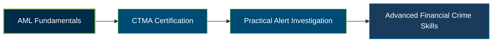

# ACAMS CTMA Certification Exam Guide

A dedicated, comprehensive study guide and transaction monitoring reference repository for candidates preparing for the **ACAMS Certified Transaction Monitoring Associate (CTMA) Certification Exam**.

---

## Exam Overview

The ACAMS CTMA Certification validates foundational knowledge of transaction monitoring, suspicious activity detection, alert investigation, and financial crime compliance processes.

- **Exam Format**: Formal certification exam administered through Pearson VUE test centers or online proctoring.
- **Target Audience**: Transaction Monitoring Analysts, AML Analysts, KYC Analysts, Compliance Operations Professionals, and Financial Crime Investigators.
- **Prerequisites**: No specific eligibility requirements for CTMA; active ACAMS membership is required to obtain and maintain the certification.

---

## Core Exam Domains & Knowledge Areas

### 1. Transaction Monitoring Fundamentals

- The role of transaction monitoring in anti-money laundering and financial crime prevention.
- Transaction monitoring processes, systems, and alert generation.
- Suspicious transaction patterns, red flags, and unusual customer activity.

### 2. Alert Review and Investigation

- Reviewing transaction monitoring alerts and assessing relevant information.
- Investigating suspicious activity using customer profiles and transaction context.
- Identifying indicators that require further investigation or escalation.

### 3. Case Resolution and Escalation

- Evaluating investigation findings and determining appropriate next steps.
- Documenting investigation activities, decisions, and supporting evidence.
- Escalating high-risk cases through established compliance procedures.

### 4. Monitoring Controls and Compliance Practices

- Applying transaction monitoring procedures within AML compliance programs.
- Recognizing the importance of consistent investigations and risk-based reviews.
- Supporting effective controls, regulatory compliance, and financial crime risk management.

---

## Certification Path

The following diagram illustrates a suggested learning progression, not an official ACAMS prerequisite or certification pathway.

---

## Recommended Practice & Study Resources

To prepare effectively, combine official ACAMS learning materials with independent practice and practical transaction monitoring study.

- **CertsGate**: Explore [CTMA certification preparation resources](https://certsgate.com/exams/acams/ctma) for supplementary study materials and practice questions to reinforce transaction monitoring concepts and identify knowledge gaps.
- **Practical Study Resource**: Review the [FATF Recommendations](https://www.fatf-gafi.org/en/publications/Fatfrecommendations/Fatf-recommendations.html) and apply AML principles to practice scenarios involving suspicious transactions, customer risk, alert investigation, and escalation.
